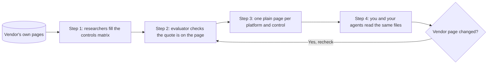

  <picture>
    <source media="(prefers-color-scheme: dark)" srcset="docs/img/hero-dark.svg">
    
  </picture>

  
  
  
  
  

  <a href="https://checkableai.com/stack-check/"><strong>Run the free AI Stack Check</strong></a>
  &nbsp;&middot;&nbsp;
  <a href="https://checkableai.com/enquire/"><strong>Make an enquiry</strong></a>

Your team wants to switch on an AI agent. The risk team asks three questions: who approves what it does, where the
data goes and what gets logged. Every vendor answers "enterprise grade", in its own words, spread over dozens of
pages. This repository closes that gap: 27 AI platforms and tools checked against the same 44 security controls, one
plain page per answer, each built on the vendor's own documentation.

> [!NOTE]
> This preview is a snapshot of our October 2026 research, read from vendor pages on 7 and 9 October 2026. A verdict
> says what a vendor documents in public. It is not a test of your own tenant, licence or settings. The free
> [AI Stack Check](https://checkableai.com/stack-check/) uses our newest checked findings.

## The problem it solves

- **Vendor claims don't line up.** Each vendor describes the same safeguard in different words, on different pages.
  Of the 1,188 platform and control pairs we read on 7 and 9 Oct 2026, 187 were fully documented and 630 in part.
- **Nobody can point to the approval.** In the same check, 4 of the 27 platforms fully documented a human approval
  bound to the exact action an agent proposes (control c1-3, Human Approval). 13 documented part of one.
- **Audit trails stop short.** None of the 27 fully documented a tamper-proof record of what each user, agent and
  session did (control c7-1, Administrative Audit). 26 documented part of one.

## What the preview shows

1. **Researchers fill the controls matrix.** Agents read each vendor's public pages and answer the same 44 controls,
   in 7 areas from identity to governance, for all 27 platforms. Each answer gets a verdict: supported, partial,
   not addressed or unresolved.
2. **The evaluator checks the quote is on the page.** It fetches the cited page, keeps a copy, finds the passage and
   quotes it, then plain code confirms the quote really is there. Records that went through this carry the receipt in
   an Evidence table. Every record names its basis in `eligibility_basis`, so you always know which kind you are
   reading.
3. **One plain page per platform and control.** The answer, the products it covers, what the sources leave open, a
   next step and the sources with their trust tier. 27 platforms by 44 controls gives 1,188 pages.
4. **You and your agents read the same files.** The pages follow Open Knowledge Format v0.2, with a retrieval index
   so a program can search without opening every page. When a vendor page changes, a freshness check sends the records
   it reaches back to the evaluator. [`examples/freshness-pull-request.md`](examples/freshness-pull-request.md) shows one
   run on a sandbox copy.

> [!TIP]
> Start with [`okf/atlas/columns/wiz/c6-1.md`](okf/atlas/columns/wiz/c6-1.md). It answers one question, whether Wiz
> keeps an inventory of the AI in your estate, and shows every part of a record, including the evaluator's quoted
> passages. No account, no install: it is a plain text page on GitHub.

## Free preview, full knowledge base

This repository is free to read, copy and build on. It holds a snapshot of 27 platforms, from model makers and
coding agents to cloud, identity, security and governance tools, which is enough to see how every record is made
and to compare the platforms you use.

The full knowledge base is the same research, much wider:

| | Free preview | Full knowledge base, by enquiry |
|---|---|---|
| Platforms and tools | 27, across 20 groups | 488 |
| Findings | 1,188 record pages from October 2026 | 22,399 findings and over 3 million connected facts |
| Anthropic, Claude Code and OpenAI | The verdict, its state and its dates for every control | Adds the vendor quotes, source links, gaps, conditions and configuration steps |
| Review | You read the records yourself | A person reviews your stack against the whole base after a short assessment |

> [!IMPORTANT]
> Keeping 488 platforms right takes ongoing research, compute for the trust checks and a person reviewing the
> findings, so the full stack review is a paid service. **[Make an enquiry](https://checkableai.com/enquire/)** and
> tell us which AI tools you use.

## Under the hood

How the research runs, with the radial map of everything we cover, is at
https://checkableai.com/stack-check/how-it-works/. The sections below hold the detail for this repository.

<strong>What is in here</strong>: the folders and what each one holds

| Folder | What it holds |
| --- | --- |
| `okf/atlas/columns/` | One folder per platform. Each has a profile, a list of its sources and one page per control |
| `okf/atlas/controls/` | One page per control: what it means, and how every platform in this preview answers it |
| `okf/atlas/AGENTS.md` and `okf/atlas/rules/` | The rules an AI agent follows when it reads these pages, and how the pages are made |
| `okf/atlas/retrieval-index.json` | One line of facts per page (verdict, state, sources), so a program can search without reading every page |
| `web/atlas-sample.json` and `app/` | The data file and reference code for a sample viewer, our Ask the Atlas questionnaire |
| `examples/` | A simulated freshness pull request: what happens when a vendor page changes |
| `docs/` | A diagram of how the research loop runs, and the banner images |

The pages follow Open Knowledge Format v0.2 (credited in [NOTICE](NOTICE)), so people and agents read the same files.

<strong>How to read one record</strong>: a walk through Wiz, control c6-1

Open [`okf/atlas/columns/wiz/c6-1.md`](okf/atlas/columns/wiz/c6-1.md). It answers one question: does Wiz keep an
inventory of the AI in your estate (control c6-1, Asset Registries and Inventory)?

The block at the top, between the two `---` lines, is the record's label. Three lines matter most:

- `verdict: "supported"` is the short answer. Other values are `partial`, `not-addressed` and `unresolved`.
- `verification: "verified"` means the evaluator found a passage on the vendor's own page that backs the verdict.
  `unverified` means the record rests on the researcher's cited sources and our reviewer's acceptance.
- `checked_on: "2026-10-09"` is the day the vendor's pages were read. Products change, so the date matters.

The page below the label reads top to bottom:

1. **Answer.** What Wiz documents: an AI inventory of models, agents, services, MCP servers, tools and identities,
   plus an AI bill of materials. It also says the inventory is discovered, not registered.
2. **Products.** Which Wiz products the answer covers.
3. **Gaps.** What the sources leave open. Here, tool schemas are not described as part of the inventory.
4. **Options.** A next step: export the inventory through the Wiz API and reconcile it against an approved register.
5. **Evidence.** The evaluator's verdict for each source, the exact passage it quoted, and whether that quote passed
   the check.
6. **Sources.** The pages behind the record and how much each one can be trusted (tier 1 is the vendor's own
   documentation).

A not-addressed record also says what kind of gap it is. `gap_kind` tells you whether the control is outside what
the product is for or a real gap in it.

<strong>Why you can trust it</strong>: vendor sources, receipts, review and what a verdict covers

- **Vendor sources only.** Every record rests on the vendor's public pages, with the exact part of the page it relies
  on. No vendor pays to be listed or can change a finding.
- **Receipts.** Where the evaluator has run, it fetched the cited page, stored a copy, found the passage and quoted
  it, and plain code confirmed the quote is on that copy. The result is the Evidence table, and you can open the
  source and check it yourself.
- **Review.** Records without an evaluator run were researched with cited sources and accepted by our reviewer for
  this research set. Each record says which of the two it is, in `eligibility_basis`.
- **What a verdict covers.** A verdict says what a vendor documents. It reads the vendor's public pages, so your own
  tenant, licence and settings are for you to confirm. Where a vendor documents nothing, the record says so. That is a
  finding about the documentation, not proof the feature is missing.

<strong>Anthropic, Claude Code and OpenAI</strong>: what their records show here

For the Anthropic platform, Claude Code and OpenAI, this preview shows the verdict for every control, its state and
its dates. The vendor quotes, source links, gaps, conditions and configuration steps for these three are the findings
buyers ask us about most, and they come with the full stack review. Every other platform here shows its records in
full.

<strong>The app folder</strong>: reference code for the Ask the Atlas viewer

`app/atlas.js` and `app/atlas.css` show how the viewer reads `web/atlas-sample.json`, routes a concern to the right
controls and checks each citation against its record. The script was written for an earlier host page: it fetches
the data from `/atlas/atlas-sample.json` and uses that page's element ids (such as `atlas-form`, `stack` and `trace`).
To try it yourself, serve the JSON at that path and give your own page those ids. The rest of the preview reads
without it.

  <a href="https://checkableai.com/stack-check/"><strong>Run the free AI Stack Check</strong></a>
  &nbsp;&middot;&nbsp;
  <a href="https://checkableai.com/enquire/"><strong>Make an enquiry</strong></a>

MIT licence, copyright (c) 2026 M. Walker, see [LICENSE](LICENSE). Quoted vendor documentation stays under its
publishers' terms, see [NOTICE](NOTICE). To report a security problem, see [SECURITY.md](SECURITY.md).
