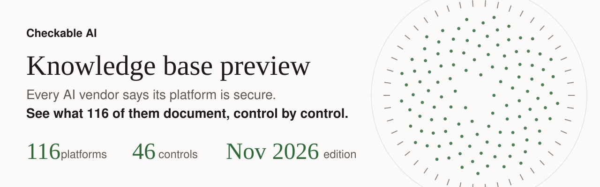

  <picture>
    <source media="(prefers-color-scheme: dark)" srcset="docs/img/hero-dark.svg">
    
  </picture>

  
  
  
  
  

  <a href="https://checkableai.com/stack-check/"><strong>Run the free AI Stack Check</strong></a>
  &nbsp;&middot;&nbsp;
  <a href="https://checkableai.com/enquire/"><strong>Make an enquiry</strong></a>

Your team wants to switch on an AI agent. The risk team asks three questions: who approves what it does, where the
data goes and what gets logged. Every vendor answers "enterprise grade", in its own words, spread over dozens of
pages. This repository puts 116 AI platforms and tools next to the same 46 security controls, with one plain page for
each answer, drawn from the vendor's own documentation.

> [!NOTE]
> **Edition: November 2026.** The live [AI Stack Check](https://checkableai.com/stack-check/) is updated daily. The full knowledge base is available by enquiry.

A verdict says what a vendor documents in public. It is not a test of your own tenant, licence or settings, so those
are for you to confirm. Every record is drawn from the vendor's own public documentation and confirmed before it is
published.

> [!TIP]
> Start with [`okf/atlas/columns/wiz/c6-1.md`](okf/atlas/columns/wiz/c6-1.md). It answers one question, whether Wiz
> keeps an inventory of the AI in your estate, and shows every part of a record. No account, no install: it is a plain
> text page on GitHub.

## Free to read, the full knowledge base by enquiry

This repository is free to read, copy and build on. It covers 116 platforms, from model makers and coding agents to
cloud, identity, security and governance tools, which is enough to see how every record is made and to compare the
platforms you use. The full knowledge base is available by enquiry, and our team reviews your stack against it after a
short assessment. **[Make an enquiry](https://checkableai.com/enquire/)** and tell us which AI tools you use.

<strong>What is in here</strong>: the folders and what each one holds

| Folder | What it holds |
| --- | --- |
| `okf/atlas/columns/` | One folder per platform. Each has a profile, a list of its sources and one page per control |
| `okf/atlas/controls/` | One page per control: what it means, and how every platform in this edition answers it |
| `okf/atlas/AGENTS.md` and `okf/atlas/rules/` | The rules an AI agent follows when it reads these pages |
| `okf/atlas/retrieval-index.json` | One line of facts per page (verdict, state, sources), so a program can search without reading every page |
| `web/atlas-sample.json` and `app/` | The data file and reference code for a sample viewer, our Ask the Atlas questionnaire |
| `examples/` | A simulated freshness pull request: what happens when a vendor page changes |
| `docs/` | A diagram of how the research loop runs, and the banner images |

The pages follow Open Knowledge Format v0.2 (credited in [NOTICE](NOTICE)), so people and agents read the same files.

<strong>How to read one record</strong>: the label and the sections

Open any page under `okf/atlas/columns/`. The block at the top, between the two `---` lines, is the record's label.
Three lines matter most:

- `verdict: "covered"` is the short answer. The other values are `partial`, `not-covered` and `out-of-scope`, and
  `escalated` marks a finding that is with our team for a decision.
- `checked_on` is the day the vendor's pages were read. Products change, so the date matters.
- `agent_eligible` says whether an agent may retrieve the page on the edition date. Every page stays open to read.

The page below the label reads top to bottom: the answer, the products it covers, the gaps the sources leave open, a
next step, the evidence and the sources with their trust tier (tier 1 is the vendor's own documentation). A
`not-covered` record also says what kind of gap it is. `gap_kind` tells you whether the control is outside what the
product is for or a real gap in it.

<strong>The app folder</strong>: reference code for the Ask the Atlas viewer

`app/atlas.js` and `app/atlas.css` show how the viewer reads `web/atlas-sample.json`, routes a concern to the right
controls and checks each citation against its record. The script was written for our own host page: it fetches
the data from `/atlas/atlas-sample.json` and uses that page's element ids (such as `atlas-form`, `stack` and `trace`).
To try it yourself, serve the JSON at that path and give your own page those ids. The rest of the edition reads
without it.

  <a href="https://checkableai.com/stack-check/"><strong>Run the free AI Stack Check</strong></a>
  &nbsp;&middot;&nbsp;
  <a href="https://checkableai.com/enquire/"><strong>Make an enquiry</strong></a>

MIT licence, copyright (c) 2026 M. Walker, see [LICENSE](LICENSE). Quoted vendor documentation stays under its
publishers' terms, see [NOTICE](NOTICE). To report a security matter, see [SECURITY.md](SECURITY.md).
